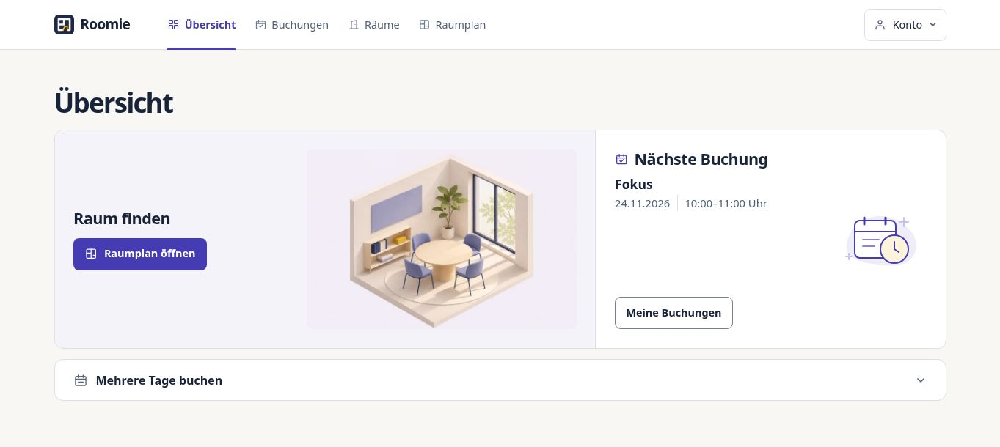
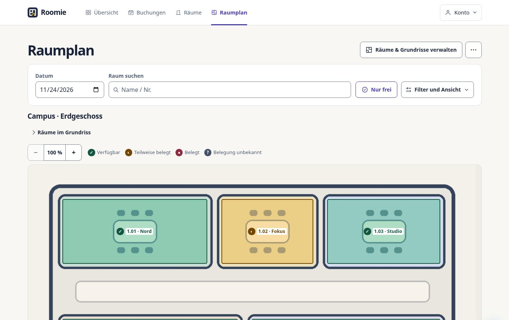
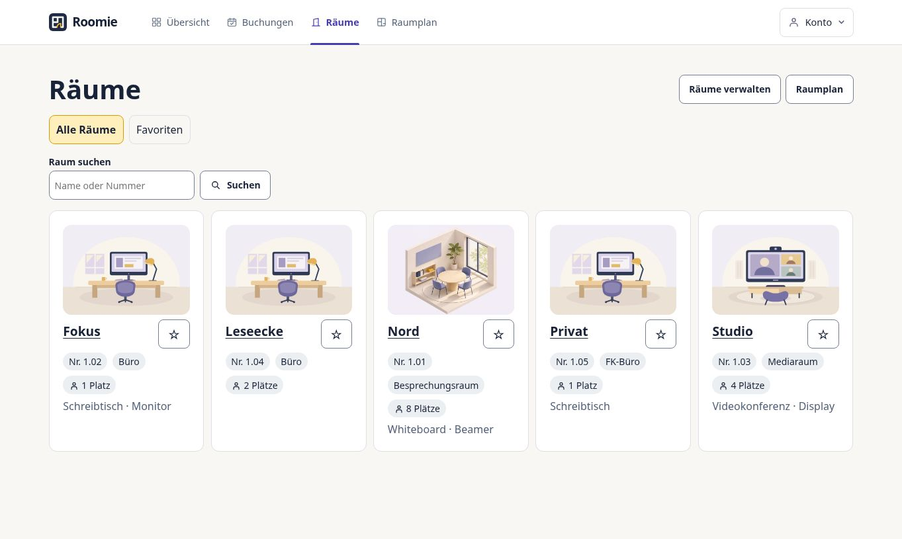
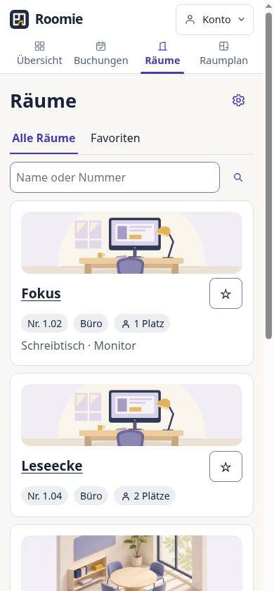
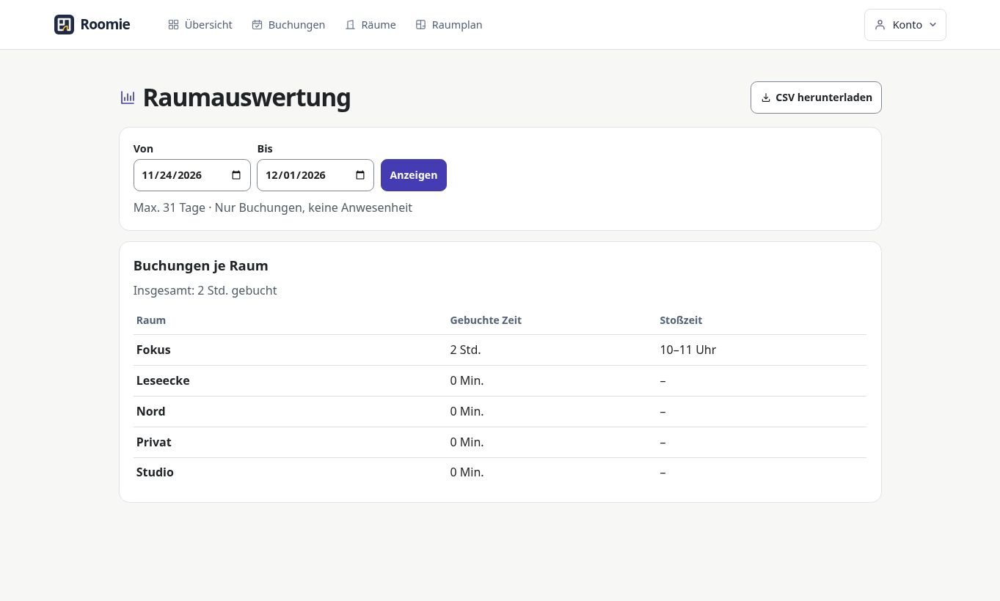

# Roomie

**Räume finden, buchen und verwalten.** Roomie ist eine selbst gehostete Web-App
für Büros und Besprechungsräume. Sie läuft im Desktop- und Smartphone-Browser,
ohne App-Installation.

## Was Roomie kann

| Bereich | Funktionen |
| --- | --- |
| **Raum finden** | Interaktiver Grundriss mit Raumzonen, Raumliste, Suche, Favoriten, Verfügbarkeits- und Ausstattungsfilter. |
| **Raum buchen** | Einzeltermine, Buchungen über mehrere Tage und wöchentliche Serien. Eigene Termine verschieben, stornieren oder als ICS herunterladen. |
| **Serie verwalten** | Für neu angelegte Serien die kommenden Termine gemeinsam prüfen, zeitlich ändern oder stornieren. Laufende und vergangene Termine bleiben unverändert. |
| **Am Raum buchen** | Gedruckten QR-Code scannen, normal anmelden und bei Verfügbarkeit den nächsten 30-Minuten-Termin buchen oder anfragen. |
| **Räume verwalten** | Grundrisse und Raumfotos hochladen, Räume markieren, Konten und Raumrechte verwalten, Sperrzeiten und Freigabepflicht setzen. |
| **Auswerten** | Gebuchte Raumzeit und Spitzenstunden für bis zu 31 Tage, mit CSV. Optionaler Check-in je Raum separat und ohne automatische Freigabe. |
| **Anbinden** | Schreibgeschützter MCP-Zugang für Buchungszeiten, API-Schlüssel in der Admin-Oberfläche. Exchange ist ein Offline-Pilot, keine aktive Anbindung. |

## Einrichten

Roomie verwendet **PHP 8.6**, SQLite und eine private Datenablage. Für eine
neue Installation:

1. HTTPS-Webserver und PHP vorbereiten. Die Datenbank liegt **außerhalb des
   Webroots und des App-Verzeichnisses**.
2. `ROOMIE_DB_PATH`, `ROOMIE_DOCUMENT_ROOT` und die Variablen für das erste
   Admin-Konto setzen. Als App-Konto einmal `php init_db.php` ausführen.
3. Im Browser anmelden. Konten legt die Administration an; es gibt keine
   öffentliche Registrierung und keine vorinstallierten Demodaten.

**Bestehende Installation?** Nicht erneut initialisieren. Vor dem Update die
[Anleitung für Sicherung, Schema und PHP-Wechsel](docs/betrieb.md#bestehende-installation)
lesen. [Vollständige Betriebsanleitung](docs/betrieb.md)

## Benutzen

- **Raumplan** oder **Räume** öffnen. Im Raumplan Datum wählen und mit
  **Nur frei** eingrenzen. In der Raumansicht den Termin buchen. Bei freigabepflichtigen
  Räumen wird daraus zunächst eine Anfrage.
- **Buchungen → Optionen** für Verschieben, Storno oder Kalenderdatei nutzen.
  Bei einer neuen wöchentlichen Serie steht dort **Serie bearbeiten**.
- **Als Admin:** Unter **Raumplan → Räume & Grundrisse verwalten** Räume,
  Zonen und Fotos bearbeiten. In den Raumdetails stehen **Sperrzeiten**,
  Freigabe, optionaler Check-in und **Raum-QR drucken** zur Verfügung.
- **Mobil:** Dieselben Buchungen und Einstellungen im Browser. Im Grundriss
  lässt sich zoomen oder über **Räume im Grundriss** direkt ein Raum auswählen.

Weitere Ansichten mit Beispieldaten

### Raumplan

### Raumübersicht

### Mobil

### Raumauswertung

## Betrieb und Schnittstellen

- [Installation, Datenschutz, Uploads und Tests](docs/betrieb.md)
- [QR-Druck konfigurieren](docs/betrieb.md#raum-qr)
- [MCP-Zugang verwalten](docs/betrieb.md#mcp-zugang)
- [Exchange-Pilot: Umfang und Prüfplan](docs/exchange-pilot.md)

[Lizenz: GPL-3.0](LICENSE)

### Optionaler Entra-Abgleich

**Konto → Entra-Abgleich** importiert Benutzer aus einer Entra-Gruppe. Unter **Konto → Berechtigungen → Entra-Raumrechte** legst du fest, welche synchronisierten Gruppen einen Raum buchen dürfen. [Einrichtung und Grenzen](docs/entra.md).
