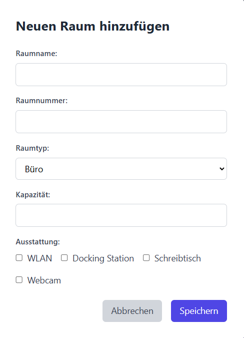

# Roomie

Roomie is a web application for managing and booking rooms in an office building.

## Features

- **📊 Dashboard**: Get an instant overview of all available rooms and their current occupancy. Never miss a free room again!
- **🗺️ Interactive Room Plan with Room Management**: Use our visually appealing grid to see rooms at a glance. Admins can easily add new rooms and manage existing ones.
- **📅 Bookings**: Plan and manage your room reservations with ease. Receive ICS files and automatic email notifications to stay updated.
- **🏢 Rooms**: Maintain control over all available rooms and their usage. Efficiently manage capacities, equipment, and availability.
- **👥 User Management**: Quickly and easily manage your users. Add new users, update information, and assign permissions in no time.

## Technologies

- **Frontend**: HTML, CSS, JavaScript, Alpine.js, Tailwind CSS
- **Backend**: PHP, SQLite

## Screenshots

### Home Page

### Bookings

### Interactive Room Plan

### Room Overview

### Permissions Matrix

### Room Administration

## Private SQLite deployment (required)

- Set `ROOMIE_DB_PATH` to an absolute SQLite path in a private directory
  outside the application checkout and the web server's document root.
  Create the directory beforehand, restrict it to the app account, and do not
  expose it through any web alias or backup download. On Linux, PHP requires
  POSIX and checks that the app account owns both the directory (e.g. mode
  0700) and the DB file (e.g. mode 0600), without group or other access.
  Use HTTPS, disable
  directory listing and apply `.htaccess` or equivalent server rules.
- For **a new empty deployment only**, set `ROOMIE_ADMIN_NAME`,
  `ROOMIE_ADMIN_EMAIL` and `ROOMIE_ADMIN_PASSWORD_HASH` in a secure local
  environment. Generate the last value with PHP `password_hash` from a strong,
  unique password; do not store the password or hash in this repo or a public
  directory. Set `ROOMIE_DOCUMENT_ROOT` to the actual absolute web document root
  for the CLI check. Run `php init_db.php` as the app account; it creates the schema and
  one configured admin, never demo users or bookings. Clear the temporary
  admin provisioning variables afterwards. Run no setup URL in the browser.
- **Existing deployment:** take it offline, preserve a verified, consistent
  backup privately, and migrate only a vetted runtime database to the new path.
  The setup refuses to overwrite an existing file. Review old accounts for
  demo credentials, revoke sessions and replace any affected credentials before
  reopening; moving the DB alone does not revoke any account.
- **Repository containment is separate:** ensure the old accidentally tracked
  database is removed from the current branch's tracking and deployment outputs
  with an authorized Git change. New ignore rules do not untrack an existing
  file or erase previous commits/forks/caches. Treat any formerly published
  data as potentially disclosed and investigate exposure before republishing.
  Do not deploy an old database from the source repository.
