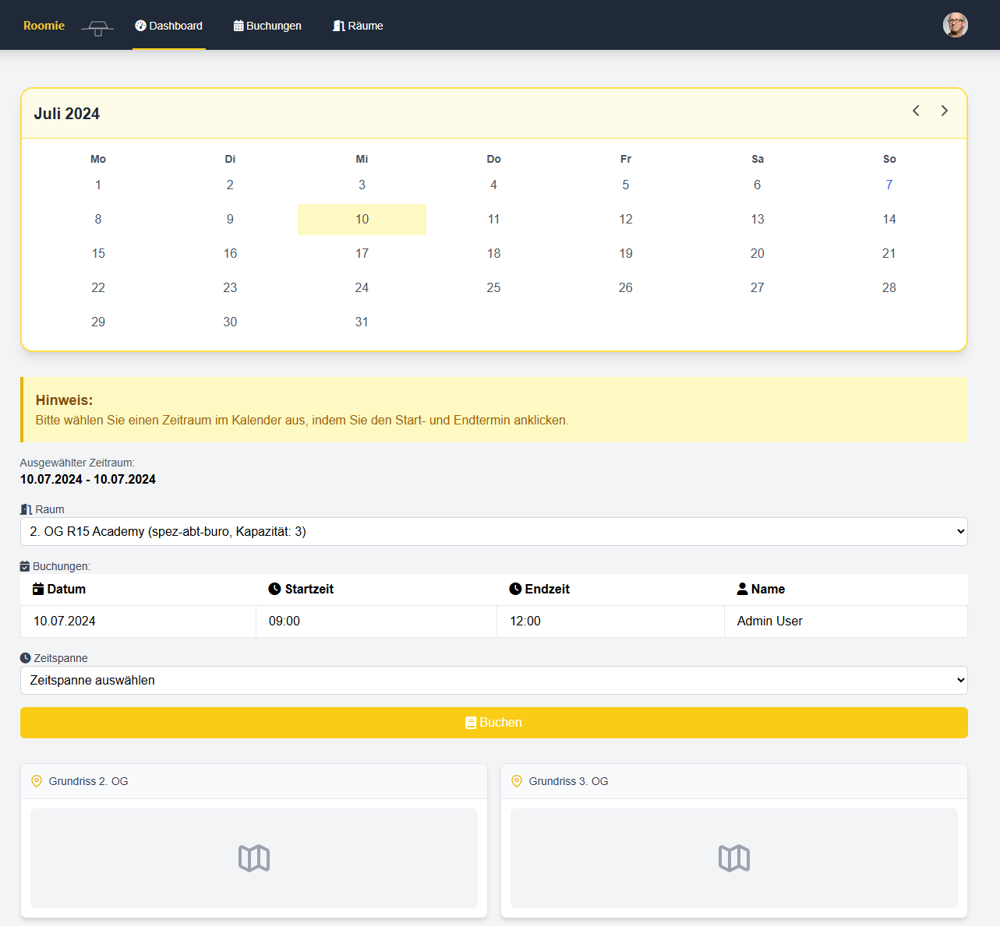
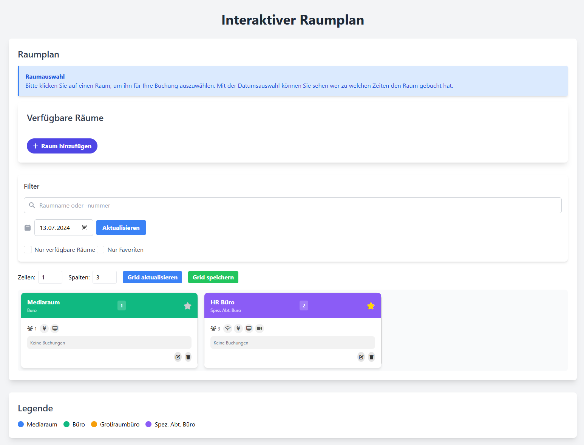
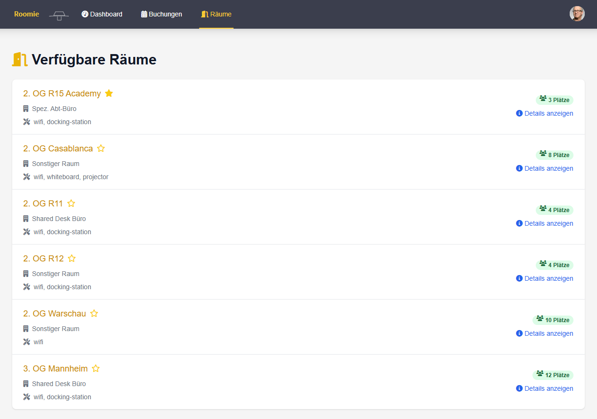
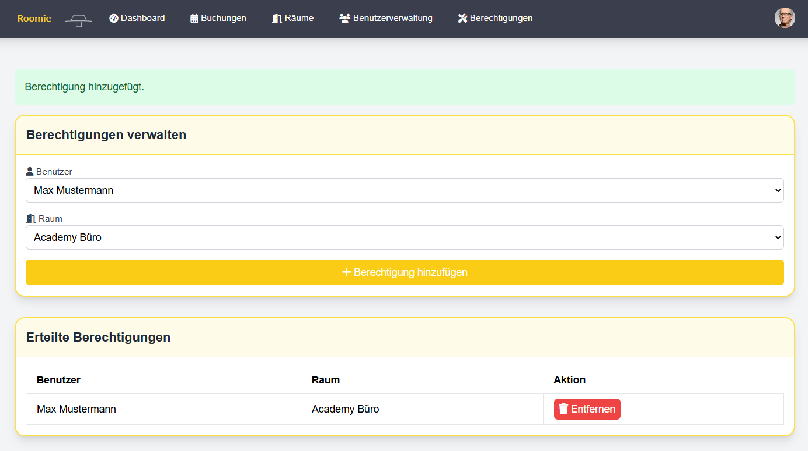

# Roomie

Roomie is a web application for managing and booking rooms in an office building.

## Features

- **📊 Dashboard**: Get an instant overview of all available rooms and their current occupancy. Never miss a free room again!
- **🗺️ Interactive Room Plan with Room Management**: Use our visually appealing grid to see rooms at a glance. Admins can easily add new rooms and manage existing ones.
- **📅 Bookings**: Plan and manage your room reservations with ease. Receive ICS files and automatic email notifications to stay updated.
- **🏢 Rooms**: Maintain control over all available rooms and their usage. Efficiently manage capacities, equipment, and availability.
- **👥 User Management**: Quickly and easily manage your users. Add new users, update information, and assign permissions in no time.

## Technologies

- **Frontend**: HTML, CSS, JavaScript, Alpine.js, Tailwind CSS
- **Backend**: PHP, SQLite

## Screenshots

### Home Page

### Bookings

### Interactive Room Plan

### Room Overview

### Permissions Matrix

### Room Administration

## Private SQLite deployment (required)

- Set `ROOMIE_DB_PATH` to an absolute SQLite path in a private directory
  outside the application checkout and the web server's document root.
  Create the directory beforehand, restrict it to the app account, and do not
  expose it through any web alias or backup download. On Linux, PHP requires
  POSIX and checks that the app account owns both the directory (e.g. mode
  0700) and the DB file (e.g. mode 0600), without group or other access.
  Use HTTPS, disable
  directory listing and apply `.htaccess` or equivalent server rules.
- For **a new empty deployment only**, set `ROOMIE_ADMIN_NAME`,
  `ROOMIE_ADMIN_EMAIL` and `ROOMIE_ADMIN_PASSWORD_HASH` in a secure local
  environment. Generate the last value with PHP `password_hash` from a strong,
  unique password; do not store the password or hash in this repo or a public
  directory. Set `ROOMIE_DOCUMENT_ROOT` to the actual absolute web document root
  for the CLI check. Run `php init_db.php` as the app account; it creates the schema and
  one configured admin, never demo users or bookings. Clear the temporary
  admin provisioning variables afterwards. Run no setup URL in the browser.
- **Existing deployment:** take it offline, preserve a verified, consistent
  backup privately, and migrate only a vetted runtime database to the new path.
  The setup refuses to overwrite an existing file. Review old accounts for
  demo credentials, revoke sessions and replace any affected credentials before
  reopening; moving the DB alone does not revoke any account.
- Do not deploy or commit SQLite files. The bundled demo database was removed
  from the current branch; older commits and copies are unaffected. Never use
  a database from the Git history for deployment.

## Accounts, visibility and mail

- The administrator provisions accounts. Public registration is disabled.
  Use verified organizational addresses before enabling mail. Only administrators
  can correct an account's address. Password and role changes revoke old sessions.
- Members see availability, not the identity of other people booking a room.
  Only a member with an explicit grant (or an administrator for room management)
  can see a restricted room. Keep at least one administrator. Accounts and rooms
  with booking history cannot be deleted through the app.
- Set `ROOMIE_MAIL_FROM` to an authorized sender address to enable transactional
  mail; otherwise booking and calendar downloads still work without sending mail.
- For an existing private database, take the app offline, preserve a verified
  backup, and run `php schema_hardening.php` with the existing private path and
  document-root environment, using the app account, before starting the new app.
  The check refuses inconsistent references and does not delete existing rows.
  Fresh installs use `init_db.php` only. Existing sessions must sign in again.
- Publish only the application, not `.git`, build tools, private data or old
  uploads. If the server does not honor `.htaccess`, apply equivalent path denies
  and security headers in the web server. Force HTTPS; behind a trusted proxy
  configure PHP to mark the session cookie Secure.
- Avatar uploads use PHP GD and private storage next to the configured database.
  Old public uploads are not reused.
