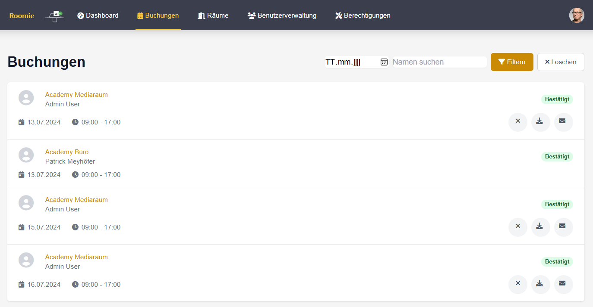

# Roomie

Roomie is a web application for managing and booking rooms in an office building.

## Features

- **Dashboard:** See your current or next booking, jump to the floor plan, or book several days.
- **Floor plans:** Upload PNG/JPEG plans, draw room zones and find available rooms directly on the plan. The room list and the legacy grid remain available.
- **Bookings:** View your bookings first, export an ICS file and cancel when eligible. Book a free time window from a room's details.
- **Rooms:** Find rooms by name or number and keep frequently used rooms in Favorites.
- **Administration:** Search and page through accounts and room permissions. Account deletion has a separate confirmation.

## Technologies

- **Frontend**: HTML, CSS, JavaScript, Alpine.js, Tailwind CSS
- **Backend**: PHP, SQLite

## Screenshots

Older screenshots, for reference:

### Home Page


### Bookings


### Interactive Room Plan


### Room Overview


### Permissions Matrix


### Room Administration


## Private SQLite deployment (required)

- Set `ROOMIE_DB_PATH` to an absolute SQLite path in a private directory
  outside the application checkout and the web server's document root.
  Create the directory beforehand, restrict it to the app account, and do not
  expose it through any web alias or backup download. On Linux, PHP requires
  POSIX and checks that the app account owns both the directory (e.g. mode
  0700) and the DB file (e.g. mode 0600), without group or other access.
  Use HTTPS, disable
  directory listing and apply `.htaccess` or equivalent server rules.
- For **a new empty deployment only**, set `ROOMIE_ADMIN_NAME`,
  `ROOMIE_ADMIN_EMAIL` and `ROOMIE_ADMIN_PASSWORD_HASH` in a secure local
  environment. Generate the last value with PHP `password_hash` from a strong,
  unique password; do not store the password or hash in this repo or a public
  directory. Set `ROOMIE_DOCUMENT_ROOT` to the actual absolute web document root
  for the CLI check. Run `php init_db.php` as the app account; it creates the schema and
  one configured admin, never demo users or bookings. Clear the temporary
  admin provisioning variables afterwards. Run no setup URL in the browser.
- **Existing deployment:** take it offline, preserve a verified, consistent
  backup privately, and migrate only a vetted runtime database to the new path.
  The setup refuses to overwrite an existing file. Review old accounts for
  demo credentials, revoke sessions and replace any affected credentials before
  reopening; moving the DB alone does not revoke any account.
- Do not deploy or commit SQLite files. The bundled demo database was removed
  from the current branch; older commits and copies are unaffected. Never use
  a database from the Git history for deployment.

## Accounts, visibility and mail

- The administrator provisions accounts. Public registration is disabled.
  Use verified organizational addresses before enabling mail. Only administrators
  can correct an account's address. Password and role changes revoke old sessions.
- Members see availability, not the identity of other people booking a room.
  Only a member with an explicit grant (or an administrator for room management)
  can see a restricted room. Keep at least one administrator. Accounts and rooms
  with booking history cannot be deleted through the app.
- Set `ROOMIE_MAIL_FROM` to an authorized sender address to enable transactional
  mail; otherwise booking and calendar downloads still work without sending mail.
- For an existing private database, take the app offline, preserve a verified
  backup, and run `php schema_hardening.php` with the existing private path and
  document-root environment, using the app account, before starting the new app.
  The check refuses inconsistent references and does not delete existing rows.
  Fresh installs use `init_db.php` only. Existing sessions must sign in again.
- Publish only the application, not `.git`, build tools, private data or old
  uploads. If the server does not honor `.htaccess`, apply equivalent path denies
  and security headers in the web server. Force HTTPS; behind a trusted proxy
  configure PHP to mark the session cookie Secure.
- Avatar uploads use PHP GD and private storage next to the configured database.
  Old public uploads are not reused.

## Room plan

Open `raumplan.php` from the Roomie navigation. The old `raumplan.html`
bookmark forwards to the integrated page. No new database schema is needed.

- The authenticated page renders the application shell and initial session state.
- `assets/roomplan/api.js` handles HTTP, legacy grid normalization and CSRF.
- `assets/roomplan/view.js` renders the room plan and booking controls.
- `assets/roomplan/editor.js` loads only when an administrator opens edit mode.
  Room changes are saved separately from layout changes; the new editor
  detects concurrent layout saves rather than silently overwriting them.
- Existing PHP endpoints remain authoritative for room visibility, user roles,
  bookings and inventory. Layout dimensions and existing placements are retained.

### Find and book a time

In the room plan, select a date and **Von** / **Bis**, then enable
**Nur freie Räume** to compare availability for that window. Choose a room
and book the selected time. Room details also accept an individual slot.
Custom slots are for one day, between 09:00 and 17:00 (Europe/Berlin), in
15-minute increments. The existing presets and multi-day booking still work.
Room permissions and available places are checked again on save; the filter
does not reserve a room. No database change is needed for custom times.

Under **Buchungen → Optionen → Verschieben**, change the date and time of an
upcoming booking in the same room. If the new time is taken or the booking has
changed since opening the form, the attempted move does not change the booking.
Multi-day bookings are listed as separate reservations; this action moves only
the selected day. The calendar download reflects the new time, but an earlier
import into Outlook or another calendar is not synchronized. No migration is
required.

Run `node --test build-files/*.test.mjs` to check the frontend data
contract without a running PHP server.

## PHP 8.6 runtime

The deployment target is PHP **8.6.x** (`.php-version`). Select it separately
for both the web handler (for example, PHP-FPM) and CLI. Changing the CLI version
alone does not switch the web app. Use the latest available 8.6 security release.

- Enable `pdo_sqlite`, `session` and `filter`; Linux installations also
  require `posix` for the private database checks. Enable `gd` with JPEG, GIF
  and PNG support if avatar uploads are used.
- Keep the private SQLite path, application user and writable session directory
  configured as before. A PHP-only upgrade does **not** change the SQLite schema.
- Back up the database and test under the new handler in staging. After selecting
  the new handler, verify login, dashboard, room plan, booking, calendar download
  and avatars if used. Check the web error log. If needed, restore the previous
  handler; keep the database unchanged.

Run the isolated application check with Python 3.9+ and the selected PHP CLI:

```sh
PHP_BIN=/path/to/php8.6 python3 build-files/php-smoke.py --expect-minor 8.6
```

It checks lint, session roles, dashboard room selection, booking, and ICS export.
When GD PNG is enabled it also checks private avatar upload and delivery. The
test uses temporary data and localhost only and sends no email. It does not
check an Apache/PHP-FPM installation or change the host's PHP selection.

### Uploaded floorplans

Admins open **Raumplan → Räume & Grundrisse verwalten** (also linked from
**Räume → Räume verwalten**) to create a room or edit its details without
opening the legacy grid. A new room is selected immediately for drawing its
zone. Use **+ Grundriss** to drop a PNG/JPEG
or select it from their device (up to 5 MiB, 2400 px per side and 3 megapixels).
Select a room and draw its zone with the mouse or tap two corners on a
touchscreen. Use **Position & Größe** for precise keyboard edits, then save the zones.
Use the plan's rename action to update its title without replacing the image
or its zones. Each plan may have up to 200 marked rooms; up to 12 plans are supported.

Use **Raum suchen** to find a marked room. Select a room to open its booking
options. The older grid and the room list remain available.

GD must be enabled. Roomie decodes the upload, stores a new PNG in the
private SQLite database and serves it only to signed-in users. Do not upload
a drawing with labels or details that should be hidden from any signed-in user:
room permissions filter interactive zones, not text baked into the image.
The normal private SQLite backup also includes floorplans and zones.

For an existing database, back up and run the additive `php schema_hardening.php`
before using the new editor. It does not alter bookings or the existing grid.
Allow enough room for multipart overhead in PHP `post_max_size` and set
`upload_max_filesize` to at least 5 MiB. A new installation gets the tables
through `init_db.php`.
